<div align="center">

# MAPE

**셀러를 위한 마케팅 의사결정 서비스**

판매처마다 흩어진 클릭과 주문을 링크 하나로 잇고,<br>
다음 달 광고비를 어디에 쓸지 세 관점의 근거와 함께 제안합니다.

Team 순우리 · 제12회 용인시 대학연합 창업아이디어경진대회 시연 버전


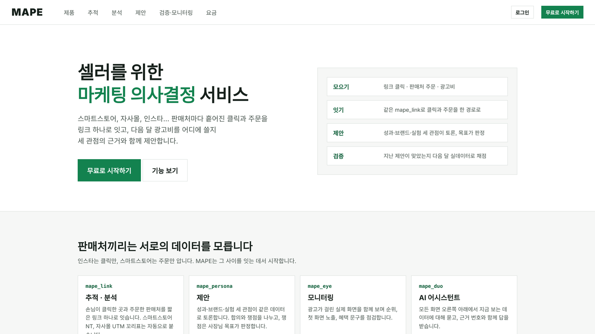

</div>

---

## 왜 만들었나

스마트스토어, 자사몰, 인스타그램, 네이버 검색광고. 작은 셀러는 여러 판매처와 광고 채널을 동시에 쓰지만, **판매처끼리는 서로의 데이터를 모릅니다.** 인스타는 클릭만 알고, 스마트스토어는 주문만 압니다. 그래서 "어느 광고가 실제로 팔았는지" 모른 채 다음 달 광고비를 감으로 나눕니다.

MAPE는 그 사이를 잇는 데서 시작합니다.

| 단계 | 하는 일 |
|---|---|
| 모으기 | 링크 클릭, 판매처 주문, 광고비를 한곳에 |
| 잇기 | 같은 링크로 들어온 클릭과 주문을 하나의 경로로 연결 |
| 제안 | 성과·브랜드·실험 세 관점이 같은 데이터를 다르게 해석하고 토론, 쟁점은 셀러의 목표가 판정 |
| 검증 | 지난 제안이 맞았는지 다음 달 실데이터로 채점 |

MAPE는 광고를 만들어 주지도, 대신 집행하지도, 정답 하나를 주지도 않습니다. **판단의 근거를 보여주는 도구**입니다.

---

## 네 가지 기술

| 기술 | 역할 | 화면 |
|---|---|---|
| `mape_link` | 광고마다 전용 링크를 만들어 클릭부터 구매까지 추적. 스마트스토어 NT, 자사몰 UTM 꼬리표 자동 부착 | 추적 · 분석 |
| `mape_persona` | 세 관점(성과·브랜드·실험)이 각자 예산 배분안을 내고 토론. 합의와 쟁점을 나누고 쟁점은 목표 비중이 판정 | 제안 · 토론 · 예산 배분 |
| `mape_eye` | 광고가 걸린 실제 검색 화면을 읽어 순위, 첫 화면 노출, 혜택 문구, 가격·리뷰를 경쟁 광고와 비교 | 모니터링 |
| `mape_duo` | 어느 화면에서든 불러 묻는 AI 비서. 지금 보는 숫자를 근거 번호와 함께 설명 | 모든 화면 오른쪽 아래 |

---

## 화면

### 1. 첫 설정: 연결하고, 링크를 바꾼다

<table>
<tr>
<td width="50%">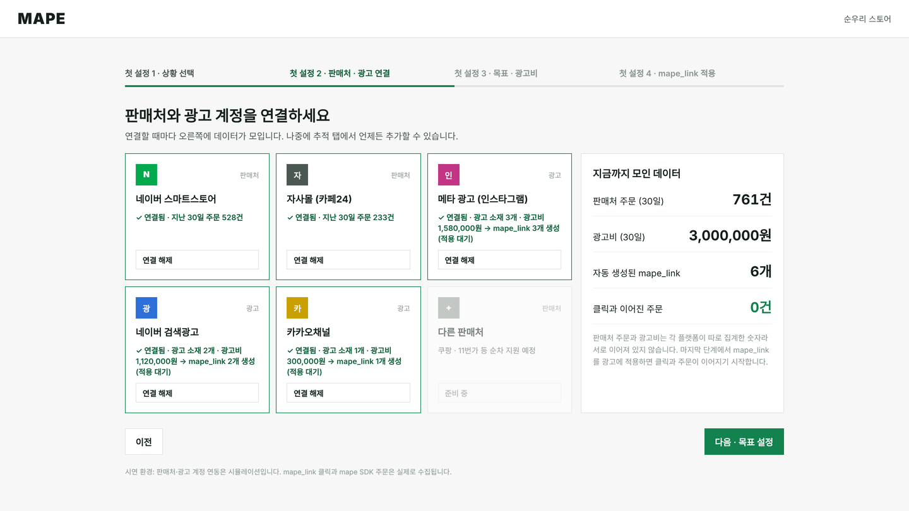</td>
<td width="50%">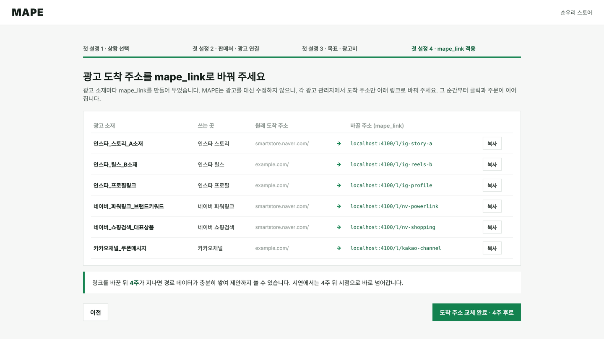</td>
</tr>
<tr>
<td>판매처와 광고 계정을 연결하면 주문과 광고비가 모이지만, 아직 <b>클릭과 이어진 주문은 0건</b>입니다.</td>
<td>광고 소재마다 만들어진 링크로 도착 주소만 바꾸면, 그 순간부터 클릭과 주문이 이어집니다.</td>
</tr>
</table>

### 2. 홈: 오늘의 판매 흐름

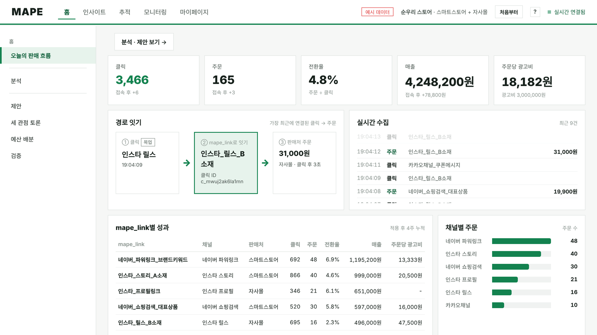

실시간으로 들어오는 클릭과 주문, 가장 최근에 이어진 경로(광고 → 링크 → 판매처 주문), 링크별 성과를 한 화면에서 봅니다.

### 3. 추적과 분석

<table>
<tr>
<td width="50%">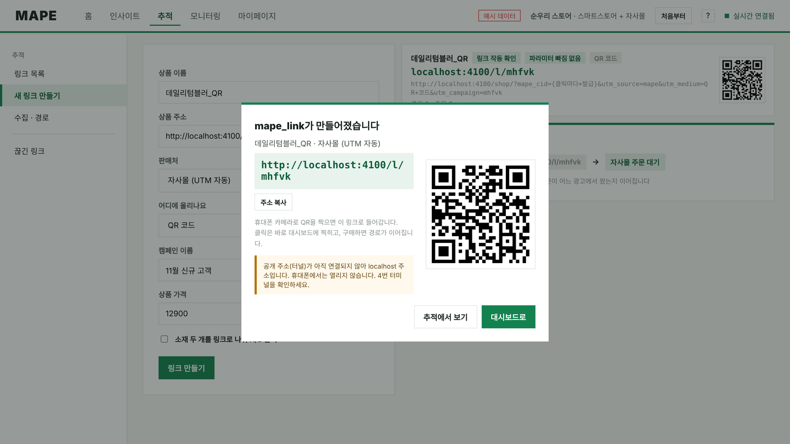</td>
<td width="50%">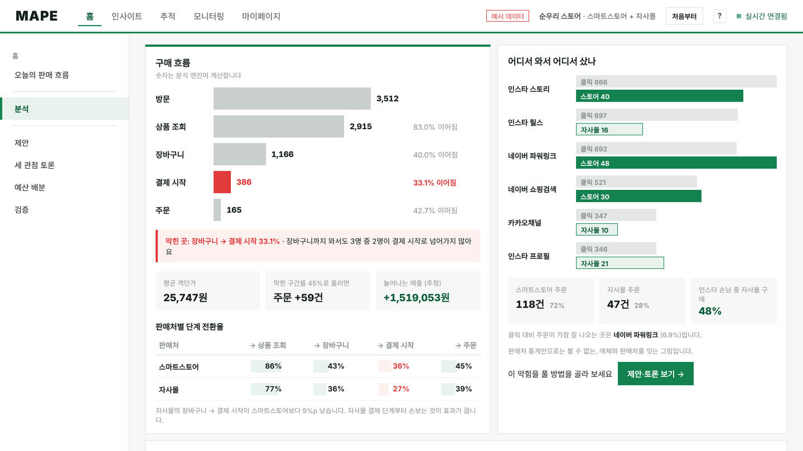</td>
</tr>
<tr>
<td>새 링크를 만들면 QR이 함께 나옵니다. 폰으로 찍고 구매하면 대시보드에 바로 반영됩니다.</td>
<td>방문부터 주문까지의 구매 흐름에서 이탈이 가장 큰 구간을 빨간색으로 표시합니다.</td>
</tr>
</table>

### 4. 제안: 세 관점 토론과 예산 배분

<table>
<tr>
<td width="50%">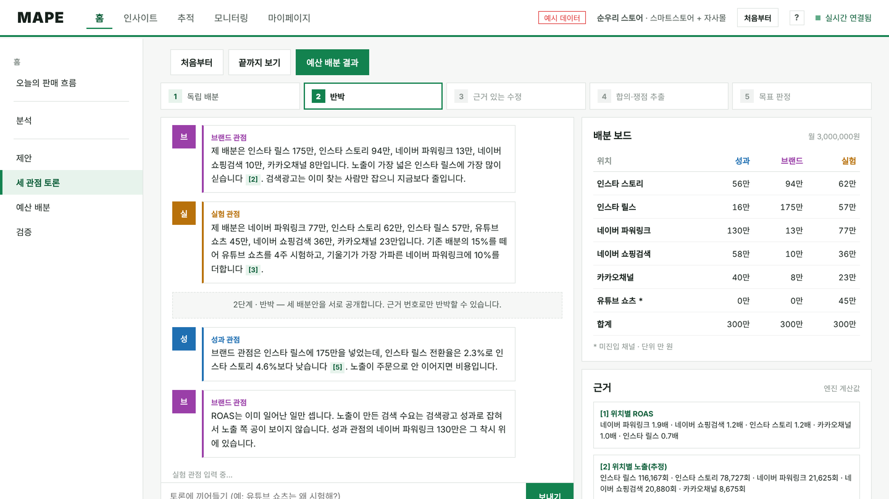</td>
<td width="50%">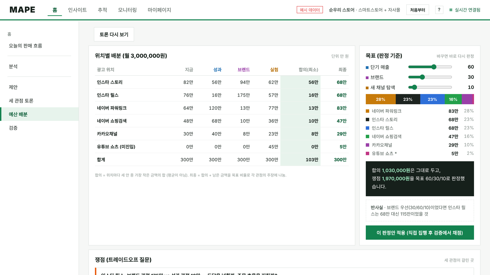</td>
</tr>
<tr>
<td>독립 배분 → 반박 → 근거 있는 수정 → 합의·쟁점 추출 → 목표 판정. 대화가 진행될수록 배분 보드가 바뀝니다.</td>
<td>세 안 모두 동의한 금액은 합의로 고정하고, 남은 쟁점 금액만 셀러의 목표 비중으로 판정합니다.</td>
</tr>
</table>

### 5. 모니터링과 AI 비서

<table>
<tr>
<td width="50%">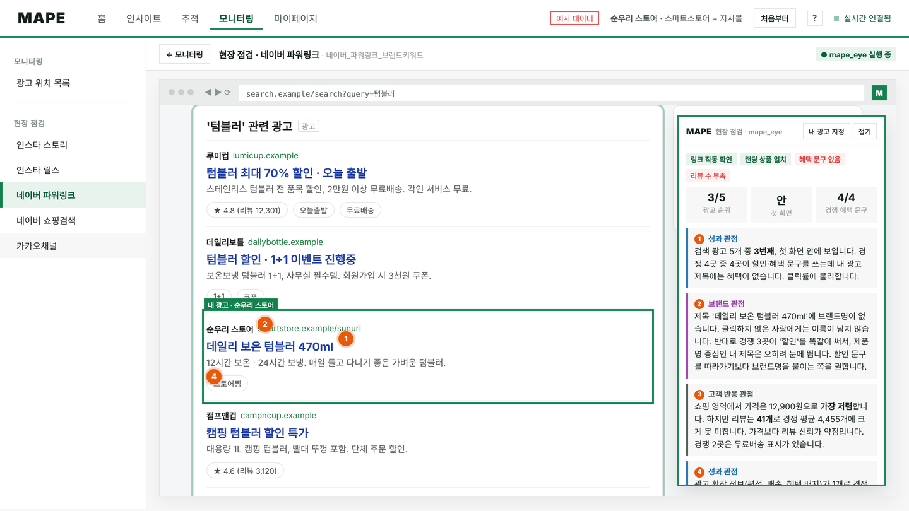</td>
<td width="50%">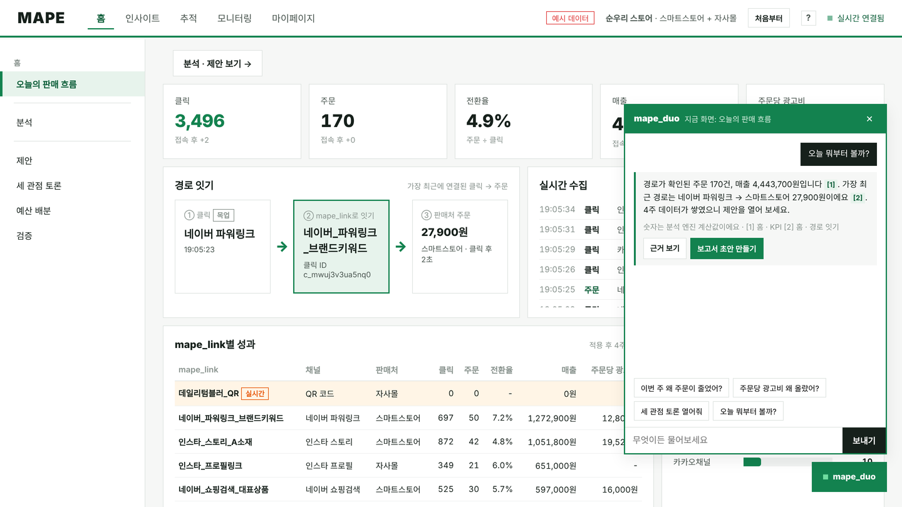</td>
</tr>
<tr>
<td><b>mape_eye</b>: 검색 결과 화면 위에서 내 광고를 세 관점으로 점검합니다.</td>
<td><b>mape_duo</b>: "오늘 뭐부터 볼까?"처럼 물으면 근거 번호를 달아 답합니다.</td>
</tr>
</table>

### 6. 인사이트와 검증

<table>
<tr>
<td width="50%">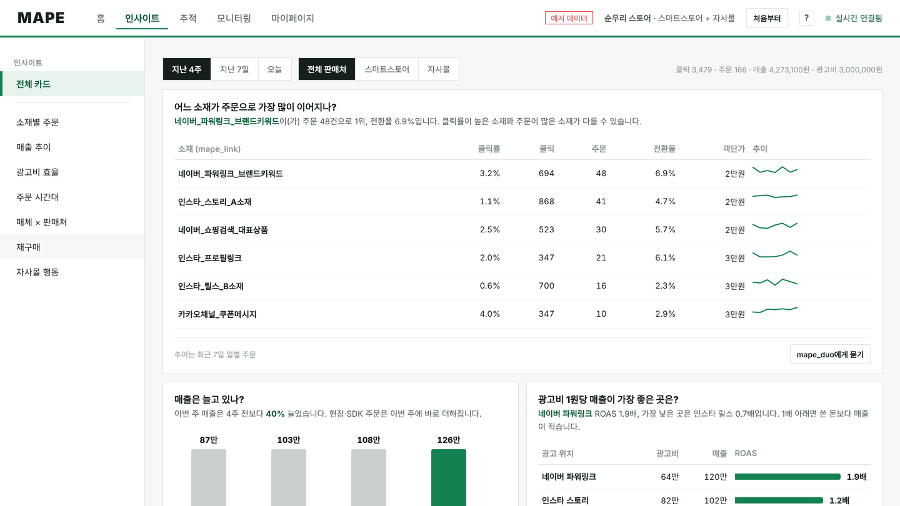</td>
<td width="50%">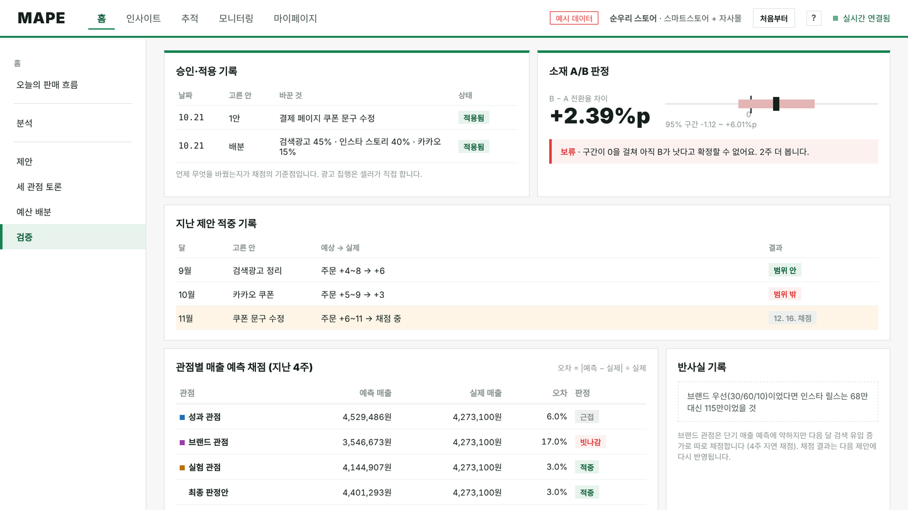</td>
</tr>
<tr>
<td>소재별 성과, 추세, 시간대, 판매처 교차 구매, 재구매를 카드로 봅니다.</td>
<td>승인·적용 기록, A/B 판정, 지난 제안 적중 기록으로 제안을 채점합니다.</td>
</tr>
</table>

---

## 빠르게 실행

외부 패키지가 없어서 `npm install`이 필요 없습니다. Node 18 이상만 있으면 됩니다.

```bash
npm start
```

http://localhost:4000 을 열면 소개 화면부터 시작합니다. API·화면, 링크(`/l/`), 시연 자사몰(`/shop/`), SDK, 목데이터가 한 포트에서 함께 돕니다.

### VS Code 시연 모드 (터미널 5개)

폴더를 VS Code로 열고 "자동 작업 허용"을 누르면 터미널 5개가 뜨고 브라우저가 열립니다. 수동 실행은 `Cmd+Shift+P` → `Tasks: Run Task` → `MAPE: 시연 전체 실행`입니다.

| 터미널 | 하는 일 |
|---|---|
| 1 API·대시보드 | 계정·연결 상태, 클릭/주문 저장, 화면에 실시간 전송 (포트 4000) |
| 2 mape_link | 링크 클릭 기록 후 상품으로 이동, 시연 자사몰, SDK 제공 (포트 4100) |
| 3 목데이터 | 광고 계정이 연결된 뒤부터 가짜 클릭·주문 생성 |
| 4 터널 | 폰용 https 주소를 만들어 화면에 등록 (`brew install cloudflared` 필요) |
| 5 시연 조작기 | 리셋, SDK 없는 판매처용 주문 연결 |

---

## 시연 순서

1. 오른쪽 위 **처음부터** → 빈 계정으로 소개 화면
2. 무료로 시작하기 → 가입 → 상황 선택 → 판매처·광고 연결 → 목표·광고비
3. 링크 적용 → "도착 주소 교체 완료 · 4주 후로" → 적용 4주 차 홈
4. 추적 → 새 링크 만들기 → QR 표시
5. 폰으로 QR 촬영 → 시연 자사몰(순우리 스토어)에서 구매
6. 대시보드에 알림, 경로 잇기, 표가 바로 반영됨 (mape SDK가 자동 전송)
7. 홈 → 분석·제안 → 세 관점 토론 → 예산 배분 결과로 이어서 설명

| 단축키 | 동작 |
|---|---|
| `Shift + D` | 첫 설정 건너뛰고 모든 연결이 끝난 홈으로 |
| `Shift + O` | 방금 QR 클릭에 주문 연결 (SDK 없는 판매처용) |
| `Shift + C` | QR 클릭 수동 기록 (폰 접속이 안 될 때) |

같은 기능이 마이페이지 → 시연 도구에 버튼으로도 있습니다.

---

## mape SDK

자사몰에 두 줄을 넣으면 방문과 구매가 링크 경로에 자동으로 붙습니다. (`packages/mape/index.js`, 브라우저 `<script>`, `import`, `require` 모두 지원)

```html
<script src="https://<mape 주소>/sdk/mape.js"></script>
<script>mape.init();</script>

<!-- 구매 완료 시 -->
<script>mape.purchase({ orderId: "A-1001", amount: 31000 });</script>
```

링크 클릭 ID(`mape_cid`)를 30일 보관하고, 구매 시 클릭 ID와 함께 주문을 보냅니다. 같은 주문번호는 한 번만 집계합니다.

---

## 배포 (Render)

1. 이 저장소를 GitHub에 올립니다
2. Render → New → Web Service → 저장소 선택
3. Build Command는 비워 두고, Start Command는 `npm start`
4. 배포된 주소를 열면 끝. 링크와 QR은 그 주소로 자동 생성됩니다

무료 플랜은 한동안 접속이 없으면 잠들 수 있으니, 발표 10분 전에 주소를 한 번 열어 두세요. 서버를 재시작하면 시연 기록은 초기화됩니다.

---

## 구조

```
MAPE_demo
├─ server
│  ├─ main.js      배포용 진입점 (한 포트에서 전부 실행)
│  ├─ api.js       계정·연결·이벤트 저장, SSE 실시간 전송, 화면 제공
│  ├─ link.js      /l/ 리다이렉트·꼬리표, /shop/, /sdk/, /collect
│  ├─ mock.js      목데이터 생성기
│  ├─ demo.js      터미널 시연 조작기
│  └─ tunnel.js    cloudflared 터널
├─ web
│  ├─ js           화면 (core, site, home, flow, persona, tabs, my, duo)
│  ├─ eye          mape_eye (실제 확장 프로그램이라면 content script)
│  ├─ search       가상 검색 포털
│  └─ shop         SDK를 심은 시연 자사몰
├─ packages/mape   mape SDK
└─ data/links.json 광고 소재·링크·시연 상품 설정
```

---

## 실제로 동작하는 것과 시뮬레이션

| 구분 | 내용 |
|---|---|
| 실제 동작 | 링크 클릭 기록·리다이렉트·꼬리표, SDK 방문·주문 수집, 클릭-주문 경로 연결, 세 관점 배분 계산, 합의·쟁점·목표 판정 계산, 검색 화면 분석(mape_eye) |
| 시뮬레이션 | 판매처·광고 계정 연동(권한 승인 화면), 가상 검색 포털과 업체, "적용 4주 후" 누적 데이터와 목업 클릭·주문, 세 관점 토론 문장(엔진 숫자로 채운 대본), 검증 탭의 지난달 기록 |

<div align="center"><sub>© Team 순우리</sub></div>
